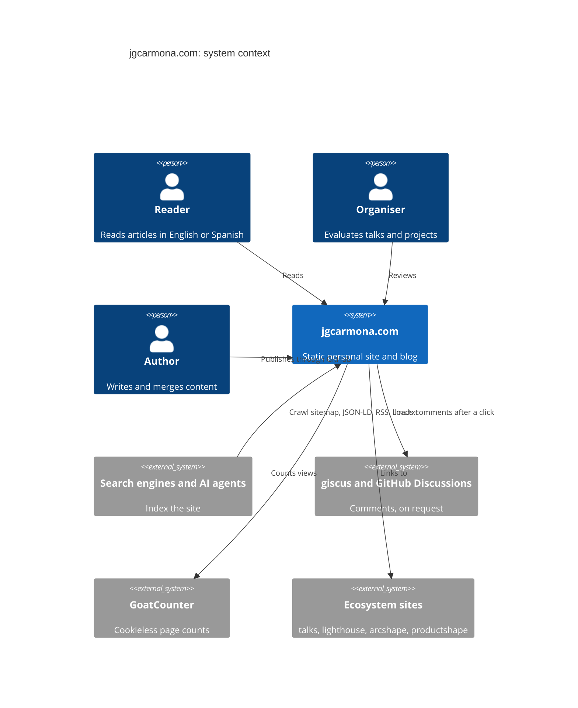

# 3. System scope and context

## Business context

## Technical context

| Interface | Consumer | Format |
| --- | --- | --- |
| HTML pages | Readers, organisers | Static HTML from Astro |
| `/sitemap-index.xml` | Search engines | Canonical URLs only |
| `/rss.xml` | Feed readers | RSS 2.0, latest 50 posts |
| `/llms.txt`, `/<lang>/<id>.md` | AI agents | llmstxt.org v2 and Markdown sources |
| `/posts.json` | Scripts | JSON list of posts |
| JSON-LD in every page | Search engines | schema.org graph with a stable Person `@id` |
