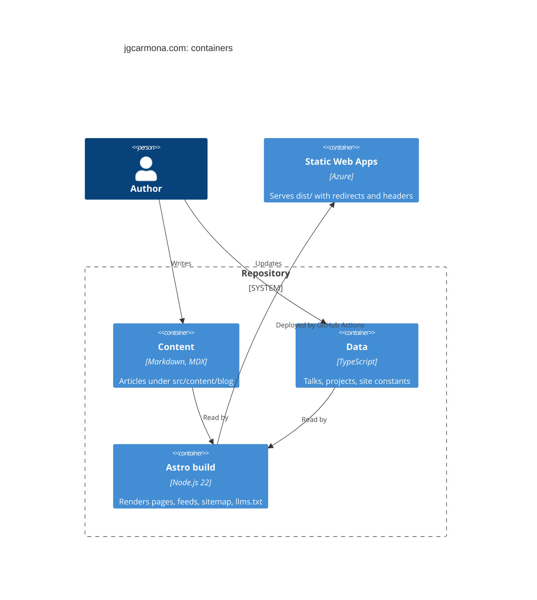

# 5. Building block view

## Level 1: system

## Level 2: building blocks

| Block | Location | Responsibility |
| --- | --- | --- |
| Content collection | `src/content.config.ts`, `src/content/blog` | Article schema and sources |
| Site data | `src/consts.ts`, `src/data/*.ts` | Identity, profiles, ecosystem, talks, projects |
| Layouts | `src/layouts/Base.astro`, `BlogPost.astro`, `Page.astro` | Page shell, article page, Markdown pages |
| Head and schema | `src/components/BaseHead.astro`, `src/utils/schema.ts` | Meta tags, social image, JSON-LD graph |
| Routes | `src/pages` | Home, blog, topics, search, talks, projects, about, privacy, feeds, redirects |
| Styles | `@juangcarmona/lighthouse-ui`, `src/styles/site.css` | Tokens, recipes and site layout |
| Build helpers | `scripts/brand.mjs`, `scripts/post-paths.mjs` | Brand assets; canonical paths for the sitemap |
