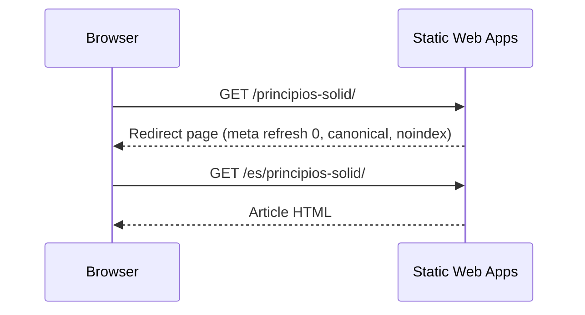

# 6. Runtime view

## Runtime scenarios

### Reading a WordPress-era link

### Opening comments

The article renders without any third-party request except GoatCounter. When the reader presses *Show comments*, the page injects the giscus client with the post title as the discussion term; giscus then loads its frame from giscus.app.

### Publishing on a date

`scheduled-publish.yml` runs daily, merges every `publish/YYYY-MM-DD-*` branch whose date has arrived into `main`, and triggers `website-cd.yml`, which builds and deploys.
