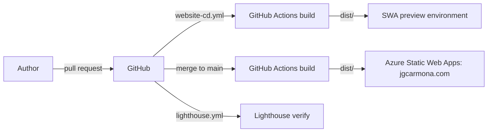

# 7. Deployment view

## Infrastructure overview

## Deployment mapping

| Artifact | Target |
| --- | --- |
| `dist/` from `npm run build` | Azure Static Web Apps, free tier |
| `public/staticwebapp.config.json` | SWA routing, 404 page, trailing slash and global headers |
| Pull request builds | SWA staging environment, closed with the pull request |
